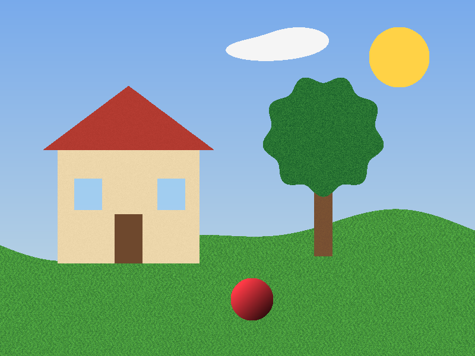
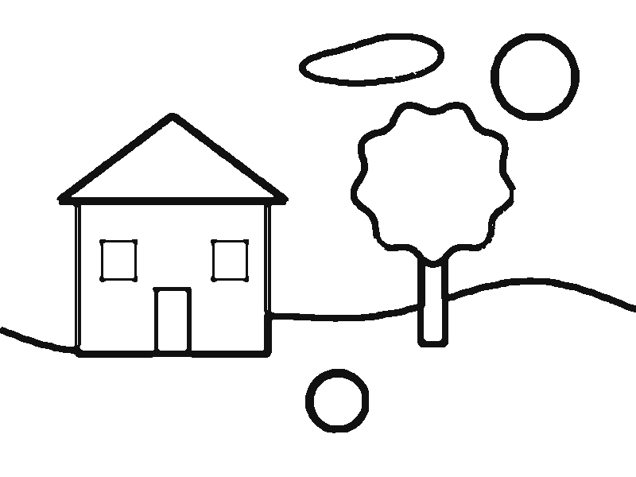

# photo-to-coloring-page

Turn a photo into black-and-white line art you can print and color. Runs entirely in the browser (or a Web Worker, or Node). No dependencies, no server, no model download.

```js
import { photoToColoringPage } from "photo-to-coloring-page";

const page = photoToColoringPage(imageData, { detail: "medium" });
ctx.putImageData(new ImageData(page.data, page.width, page.height), 0, 0);
```

## Before / after

| Input (synthetic test scene) | Output |
| --- | --- |
|  |  |

The input is a procedurally drawn scene (`demo/synthetic-scene.js`), not a real photo. It has deliberate noise on the grass, tree crown and walls. The output keeps the outlines of the house, roof, windows, door, tree, sun, cloud, ball and horizon. The texture inside them is dropped, so every shape is a clean area to color in. Regenerate with `npm run example`.

## Demo

`demo/index.html` is a single static page: pick a photo, see the coloring page, download a PNG. It is plain JavaScript with no build step. Your photo stays on your device and nothing is uploaded.

ES modules don't load from `file://`, so serve the folder with any static server:

```sh
npx serve .          # or: python3 -m http.server 8080
# open http://localhost:8080/demo/
```

## Install

```sh
npm install github:jackships/photo-to-coloring-page
```

Or copy `src/index.js` (and `src/worker.js` if you want the worker) into your project. It is one file with no imports.

## Usage

### Browser (main thread)

```js
import { photoToColoringPage } from "photo-to-coloring-page";

const bitmap = await createImageBitmap(file, { imageOrientation: "from-image" });
const canvas = document.createElement("canvas");
const scale = Math.min(1, 2000 / Math.max(bitmap.width, bitmap.height)); // keep input reasonable
canvas.width = Math.round(bitmap.width * scale);
canvas.height = Math.round(bitmap.height * scale);
const ctx = canvas.getContext("2d");
ctx.fillStyle = "#fff";
ctx.fillRect(0, 0, canvas.width, canvas.height);
ctx.drawImage(bitmap, 0, 0, canvas.width, canvas.height);

const page = photoToColoringPage(ctx.getImageData(0, 0, canvas.width, canvas.height), {
  detail: "medium",
  outputSize: 2400, // long side in px; ~8 in at 300 DPI
});

const out = document.createElement("canvas");
out.width = page.width;
out.height = page.height;
out.getContext("2d").putImageData(new ImageData(page.data, page.width, page.height), 0, 0);
out.toBlob((png) => { /* download or display */ }, "image/png");
```

### Web Worker (recommended for photos)

A 2000 px photo takes a few hundred milliseconds, so run it off the main thread. `src/worker.js` is a ready-made module worker:

```js
const worker = new Worker(new URL("photo-to-coloring-page/worker", import.meta.url), { type: "module" });
// without a bundler: new Worker("./node_modules/photo-to-coloring-page/src/worker.js", { type: "module" })

function toColoringPage(imageData, options) {
  const id = Math.random();
  return new Promise((resolve, reject) => {
    worker.addEventListener("message", function on(e) {
      if (e.data.id !== id) return;
      worker.removeEventListener("message", on);
      e.data.error ? reject(new Error(e.data.error)) : resolve(e.data); // { data, width, height }
    });
    worker.postMessage(
      { id, data: imageData.data, width: imageData.width, height: imageData.height, options },
      [imageData.data.buffer] // transfer, no copy
    );
  });
}
```

### Node

Takes any RGBA buffer, so it works with whatever decoder you already use (`sharp`, `pngjs`, `@napi-rs/canvas`, and so on):

```js
import { photoToColoringPage } from "photo-to-coloring-page";

const { data, width, height } = photoToColoringPage(rgbaBuffer, srcWidth, srcHeight, { outputSize: 2400 });
```

### Input forms

- `photoToColoringPage(imageData, options?)`: `ImageData` or any `{ data, width, height }`.
- `photoToColoringPage(rgba, width, height, options?)`: `Uint8ClampedArray`, `Uint8Array` or `ArrayBuffer` of RGBA pixels.

Both return `{ data: Uint8ClampedArray, width, height }` (RGBA) with the same aspect ratio as the input. Transparent input pixels count as white paper.

## Options

| Option | Type | Default | What it does |
| --- | --- | --- | --- |
| `detail` | `"low" \| "medium" \| "high"` | `"medium"` | Preset. `low` gives fewer, bolder lines (good for young kids). `high` keeps smaller features. |
| `lineWeight` | number, 0.25–4 | `1` | Line thickness multiplier. Use 1.5–2 for crayons and 0.75 for fine pens. |
| `threshold` | number | preset (6.5 / 5 / 4) | Edge strength needed to start a line. Higher means fewer lines; lower picks up faint edges. |
| `minStrokeLength` | number (px) | preset (60 / 40 / 24) | Strokes shorter than this, measured at working size, are removed. This is the main speck and texture cleanup. |
| `smoothing` | integer | preset (5 / 4 / 3) | Bilateral smoothing passes before edge detection. More passes flatten more texture. |
| `workSize` | number (px) | preset (520 / 680 / 860) | Long side of the internal working image. Larger is slower and finer. |
| `outputSize` | number (px) | input long side | Long side of the result. Use 2000–2400 for printing. |
| `invert` | boolean | `false` | White lines on black. |
| `transparent` | boolean | `false` | Background alpha 0, so the lines can sit on top of other artwork. |
| `ink` | `[r, g, b]` | `[17, 17, 17]` | Line colour. Ignored when `invert` is set. |

`PRESETS` is exported if you want to read the defaults.

## How it works

1. **Shrink.** The photo is area-averaged down to a working size of about 520–860 px on the long side. This sets the scale of detail and keeps it fast.
2. **Flatten texture.** A bilateral filter runs a few times. It blurs areas of similar colour (grass, sand, fur, skin) but stops at strong colour changes, so outlines survive and texture does not.
3. **Find edges.** A difference of Gaussians (two blurs subtracted) runs on brightness and on two colour-opponent channels (red–green and yellow–blue). The colour channels catch edges such as a golden dog on green grass, where the brightness is about the same. Brightness is contrast-stretched first, so dim photos still work.
4. **Connect lines.** A hysteresis threshold is applied. Strong edges start a line, and weaker edges are kept only where they touch a strong one. Outlines come out long and unbroken instead of dashed.
5. **Remove specks.** Connected groups of line pixels smaller than `minStrokeLength` are deleted.
6. **Draw cleanly.** The line mask is lightly blurred, scaled to the output size and thresholded again. Lines end up an even width with rounded ends and no grey pixels, ready for a printer or a paint-bucket tool.

Everything is plain loops over typed arrays. On a laptop, an 800×600 input takes about 0.4 s in Node at the default settings.

## Limitations

- **It traces edges; it doesn't understand the picture.** Busy backgrounds, harsh shadows and strong reflections can become lines. Photos with one clear subject and a plain or blurred background work best.
- **Faces and small details** are hard to get right with any edge filter. Eyes can merge or drop out depending on lighting. Try `detail: "high"` with a lower `threshold`, or crop closer.
- **Shapes are not guaranteed to be closed.** A low-contrast stretch of an outline can leave a gap, which matters if you use a paint-bucket fill.
- **No style transfer.** You get the photo's own outlines, not a cartoon redraw.
- Single-threaded CPU code. Very large inputs are first reduced to `workSize`, so detail beyond that is not used.

Want AI-cleaned pages, name frames and printable books? See Linecraft (https://linecraft.page).

## Development

```sh
npm test               # node --test, synthetic images only
npm run example        # regenerate examples/*.png
```

Requires Node 18+. No dependencies.

## License

MIT © 2026 Jack Ships
